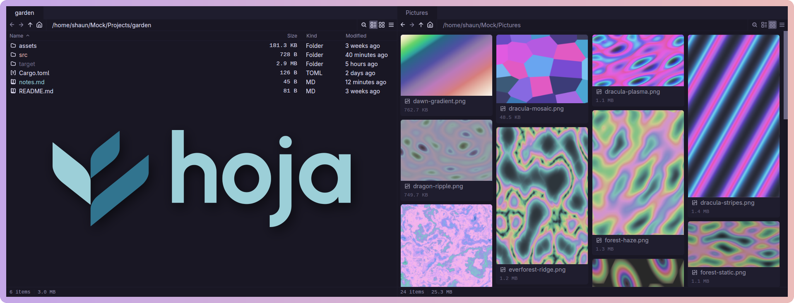
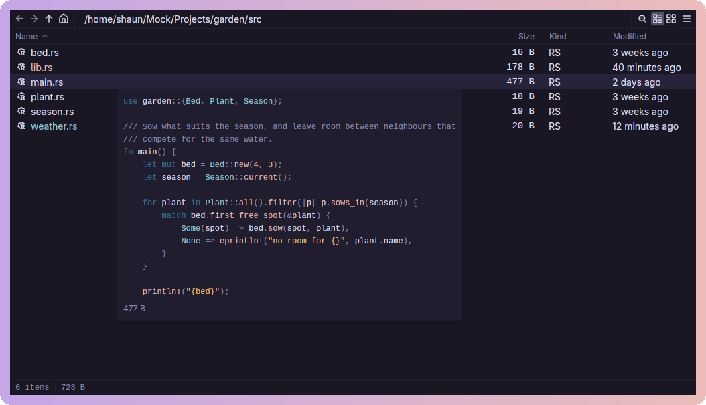
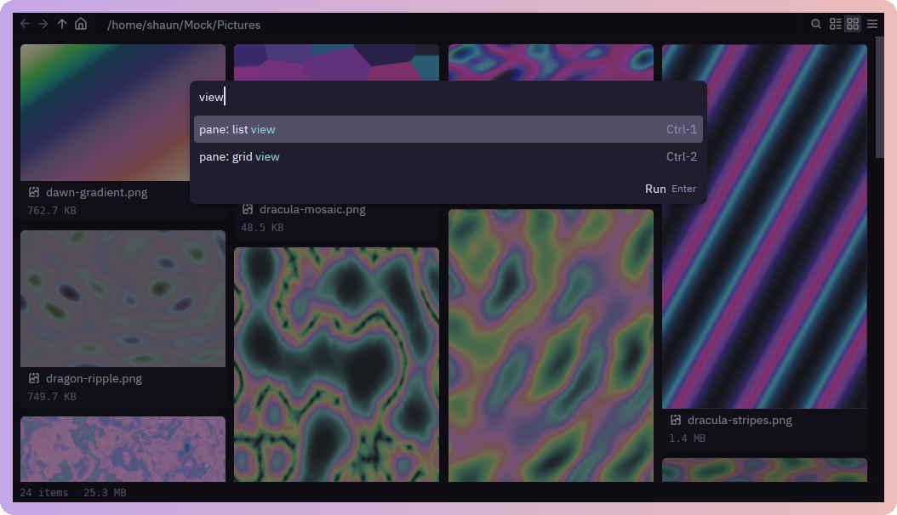

# hoja

GPU-accelerated file manager for Linux, built with GPUI.




[](https://www.gpui.rs/)

**Hoja** (OH-hah) is a file manager for Linux. It runs on Wayland and renders
via [GPUI](https://www.gpui.rs/), the GPU-accelerated framework from the Zed
editor. It features recursive pane layouts with tabs, a list or a grid of
cards, hover previews, background folder size calculation, optimized file
transfers, undoable deletes, live directory updates, and archive browsing that
feels like working with ordinary folders.

> [!WARNING]
> Hoja is experimental software. Use at your own risk.

<p>
  
  
</p>

## Features

### Panes and tabs

- Splits the window into panes, and splits any pane again, into any layout
- Holds tabs in each pane, as Zed does. Drag a tab to another pane, or to the
  edge of a pane to split a new pane off there
- Keeps a history in each tab, and goes back, forward, up or home
- Stays smooth in very large folders, because it draws only the rows you see
- Calculates folder sizes in the background, and shows each size only when it
  is final
- Sums up each pane in a footer: items and size, the selection, or the
  progress of a search
- Dims the panes that do not have focus, but keeps their Git colors
- Keeps hidden files, folder grouping and sort order separate in each pane
- Watches every folder it shows, and refreshes without losing your selection

### Viewing files

- Shows a pane as a list with the columns you choose, or as a grid of cards
  that take the shape of their pictures
- Previews a file when the pointer rests on it: the picture, a PDF's first
  page, an audio file's tags, or the first lines of text with Zed's syntax
  colors
- Gets pictures of other types, such as fonts and office documents, from the
  freedesktop thumbnailers installed, and shares their cache with other file
  managers
- Includes `hoja-model-thumbnailer`, which makes pictures of STL, 3MF and
  G-code files for Hoja and for other file managers
- Opens `.zip` and tar archives as read-only folders, and shows the members
  of a tar as they stream in
- Opens files and folders for other applications as their file picker,
  through the desktop portal, with `hoja-portal`

### File operations

- Copies and moves by the fastest correct method: `rename()`, reflinks, or
  `copy_file_range()`. Sparse files, permissions, timestamps, extended
  attributes and links stay as they were
- Undoes a delete or a transfer with `ctrl-z`, and first checks that nothing
  changed since
- Deletes to the freedesktop trash, which other Linux file managers share
- Drags and drops between panes, onto folders, and into other applications
- Copies and pastes files with other file managers, in the GNOME clipboard
  format
- Shows the bytes, speed, time left and file count of each transfer, and lists
  each file that failed
- Pauses and resumes transfers, one at a time or all with `ctrl-shift-space`
- Clears up after a transfer that was killed, and offers to finish it
- Sends a desktop notification when a long transfer finishes or a transfer
  fails

### Navigation and search

- Searches every folder below the current one with `ctrl-f`, in archives
  too, and lists results as it finds them
- Jumps to home, bookmarks and drives with `ctrl-p`, and mounts or ejects
  drives
- Runs any command from a palette with `ctrl-shift-p`, as Zed does, with the
  commands you use most at the top

### Appearance

- Shows modified times as `just now`, `3 hours ago` or `2 months ago`
- Colors names by Git status, as Zed's project panel does, and follows changes
  made in a terminal
- Reads Zed themes and Zed icon themes, and reloads them when they change.
  Rosé Pine is included
- Reads a settings file that it never rewrites, and applies each change when
  you save

[docs/features.md](docs/features.md) describes each feature in full.

## Install

### From the AUR

```sh
yay -S hoja-git
```

### From the repo's PKGBUILD

On Arch Linux, build the package from `packaging/`:

```sh
cd packaging && makepkg -si
```

It builds from the current `main`, since there are no releases yet.

### Optional packages

Hoja starts without any of these, and each adds something:

- `ffmpegthumbnailer`, or another freedesktop thumbnailer such as `totem`:
  pictures of videos.
- `papers` or `evince`: pictures of PDFs. `poppler` adds a PDF's page count
  and page shape.
- `hoja-model-thumbnailer`, which `packaging/PKGBUILD` builds with Hoja:
  pictures of STL, 3MF and G-code files.
- `hoja-portal`, which `packaging/PKGBUILD` builds with Hoja too: Hoja as the
  file picker of other applications. See below.
- `git`: names colored by Git status.
- `udisks2`: mounting drives from the place finder.
- `wl-clipboard`, `xdg-utils`, `libnotify` and `shared-mime-info`: the
  clipboard, opening files, notifications, and the Open With menu.

### Use Hoja as the file picker

Applications that ask the desktop portal for a file, such as Chrome, Zed,
Electron applications and Flatpaks, can get Hoja instead of the GTK dialog.
Install `hoja-portal`, then add one line under `[preferred]` in your portal
config. That is `~/.config/xdg-desktop-portal/portals.conf`, or
`hyprland-portals.conf` in the same folder (named for your desktop) when you
have one, because that file wins. Keep the lines already there:

```ini
[preferred]
default=gtk
org.freedesktop.impl.portal.FileChooser=hoja
```

If neither file exists, create `portals.conf` with the lines above, and
`default=` naming your desktop's backend first, for example
`default=hyprland;gtk`.

Then restart the portal:

```sh
systemctl --user restart xdg-desktop-portal
```

Firefox asks the portal only when `widget.use-xdg-desktop-portal.file-picker`
is `1` in `about:config`.

Hoja answers save dialogs too: you type a name, or pick a file to replace.

The picker's window has the app_id `hoja-picker`. A Hyprland rule can float
it:

```lua
hl.window_rule({
	name = "hoja-picker",
	match = { class = "^(hoja-picker)$" },
	float = true,
	size = "960 640",
	center = true,
})
```

`hoja --pick` works without the portal too: it reads a request as JSON on
stdin and writes what you pick on stdout. See
[docs/features.md](docs/features.md#file-picker).

### From source

1. Install Rust 1.98 or later. The Zed source sets this minimum.
2. On Arch Linux, install these packages:
   `clang cmake pkgconf fontconfig freetype2 wayland wayland-protocols
   libxkbcommon libxkbcommon-x11 vulkan-icd-loader alsa-lib openssl zstd`
3. Run `cargo build --release`. This builds Hoja only. To build the model
   thumbnailer and the portal backend too, run
   `cargo build --release --workspace`.

Note: Cargo compiles GPUI with your local toolchain. The toolchain file in the
Zed repository does not apply to git dependencies.

## Usage

```sh
hoja [OPTIONS] [PATH]...
```

Each path opens in a tab. A file opens its folder with the file selected.
`hoja --help` lists the options. The `HOJA_THEME` environment variable also
sets the theme.

Keys work on the pane that has focus. [docs/keys.md](docs/keys.md) lists every
key and mouse binding.

## Configuration

Write `~/.config/hoja/settings.json`. Every field is optional, comments are
allowed, and Hoja applies a change as soon as you save.

```jsonc
{
  // A theme in ~/.config/hoja/themes/, or a bundled Rosé Pine variant.
  "theme": "Rosé Pine Moon",

  // Font families, as `fc-list : family` names them. "font" is the interface;
  // "mono_font" sets sizes, dates, and transfer figures, so keep it monospaced.
  // Leave either out for the default. A name that isn't installed is reported
  // and ignored.
  "font": "Inter",
  "mono_font": "JetBrains Mono",

  // The size of interface text in pixels, as Zed's "ui_font_size". Leave it
  // out to use Zed's, or 16.
  "font_size": 14,

  // A preview when the pointer rests on a file. On by default.
  "previews": true,

  // A Zed icon theme, by name or by family. Leave it out to use Zed's.
  "icon_theme": "Colored Zed Icons Theme",

  // What a new pane shows.
  "view": {
    // "list" or "grid", and the width the grid's cards aim at, in pixels.
    "layout": "list",
    "card_width": 220,

    "sort": { "key": "name", "direction": "ascending" },
    "show_hidden": false,
    "folders_first": true,

    // Only the columns you name change. The others keep their usual state.
    "columns": { "permissions": true },

    // Or give a list, which sets the order as well as the set. A list shows
    // the columns it names and hides every other one.
    // "columns": ["permissions", "size", "modified"]

    // What a card shows under its name in the grid, in the same two shapes.
    // A map changes the card default, which is the size alone.
    "card_details": { "modified": true }
  }
}
```

`--theme` on the command line, then `$HOJA_THEME`, then this file.

What you change through the interface is kept in a state file of its own; see
[docs/configuration.md](docs/configuration.md).

## How it works

The `hoja-transfer` crate contains the transfer engine. It is a standard
Rust library with no UI dependencies. One worker thread does each job. The UI
reads progress from atomic counters. Each job also records what it changed, in
the form that reverses it, which is what undo replays.
[docs/architecture.md](docs/architecture.md) has the details and the engine's
tests.

## Development

CI runs on every push and pull request, and the same three commands run
locally:

```sh
cargo fmt --all --check
cargo clippy --workspace --all-targets -- -D warnings
cargo test --workspace
```

Clippy runs again in release, which is the one profile where dead code shows
up differently: a method reached only from a debug assertion is live in one and
not the other.

- [docs/testing.md](docs/testing.md): the nested-sway interface harness and its suites
- [scripts/readme-shots/](scripts/readme-shots/run.sh): retakes the pictures in this README
- [docs/architecture.md](docs/architecture.md): the transfer engine and its tests
- [docs/roadmap.md](docs/roadmap.md): what is planned

## Acknowledgments

Hoja is built on the work of the [Zed](https://zed.dev/) team: the GPUI
framework, the `theme` and `file_icons` crates, the icon set, and the theme
and icon-theme formats it reads. Much of how its panes, tabs and command
palette behave follows Zed.

## License

The license of Hoja is GPL-3.0-or-later. See [LICENSE](LICENSE).

GPUI has the Apache-2.0 license. The Zed `theme` and `file_icons` crates have
the GPL-3.0-or-later license. This is why Hoja uses the GPL.

The included assets have their own licenses:

- The icons Hoja's own interface uses are Zed's, which are Lucide's redrawn,
  and three more from Lucide in the same style, all under the ISC license.
  The file-type icons are Zed's set, which includes brand and language marks
  belonging to their own projects. See [assets/icons/LICENSES](assets/icons/LICENSES).
- The Rosé Pine themes have the MIT license. See
  [assets/themes/rose-pine/LICENSE](assets/themes/rose-pine/LICENSE).
