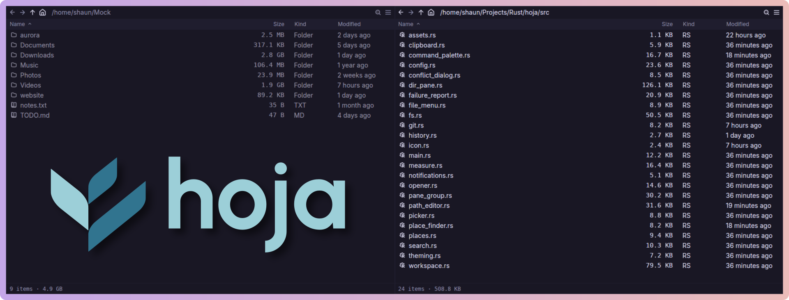

# hoja

GPU-accelerated file manager for Linux, built with GPUI.




[](https://www.gpui.rs/)

**Hoja** (OH-hah) is a file manager for Linux. It runs on Wayland and renders
via [GPUI](https://www.gpui.rs/), the GPU-accelerated framework from the Zed
editor. It features recursive pane layouts, background folder size
calculation, optimized file transfers, undoable deletes, live directory
updates, and archive browsing that feels like working with ordinary folders.

> [!WARNING]
> Hoja is experimental software. Use at your own risk.

## Features

### Panes

- **Recursive pane layout.** Split the window into panes. Each pane shows one
  directory, and panes can be split recursively into any layout.
- **Fast directory listings.** Rows are virtualized, so even very large
  directories stay smooth while scrolling.
- **Independent navigation.** Every pane has its own history. Go back,
  forward, up, or home, or click the path to jump to another location.
- **Recursive folder sizes.** Folder sizes are calculated in the background
  and appear only when complete, so values never count upward in the listing.
  Sorting by size happens once, after every folder has a final value.
- **Pane footer.** Each pane summarizes exactly what it contains: total items
  and size, selected files, permissions and ownership for a single file, or
  live search progress.
- **Clear active pane.** The active pane keeps full emphasis while inactive
  panes dim their names, icons, paths, and selections. Git status colours are
  preserved.
- **Per-pane view settings.** Hidden files, folder grouping, and sort order
  are configured independently for each pane. Hidden files are off by
  default.
- **Archives as folders.** Browse `.zip`, `.tar`, `.tar.gz`, `.tar.bz2`,
  `.tar.xz`, and `.tar.zst` archives like directories. Tar archives stream
  while loading so files appear immediately, and archive folders report their
  recursive sizes instantly. Copy files out using the keyboard, context menu,
  or drag and drop. Archives are always read-only.
- **Live listings.** Hoja watches every directory it displays. If another
  program changes the contents, the pane refreshes without losing your
  selection. If the directory disappears, Hoja moves to the nearest existing
  parent.

### File operations

- **Optimized transfers.** Hoja automatically chooses the fastest correct
  method for every transfer: `rename()` for moves on the same filesystem,
  reflinks on supported filesystems, and `copy_file_range()` elsewhere with
  fallbacks. Sparse files, permissions, timestamps, extended attributes,
  symlinks, and hardlinks are preserved.
- **Undo.** Press `ctrl-z` to take back the last thing you did, whether that
  was a delete or a transfer. `delete` moves files to the freedesktop trash,
  which is instant on the same filesystem and compatible with other Linux file
  managers. Undoing a transfer removes what it copied and restores anything it
  replaced. It checks first: a file edited since the transfer is left alone
  and reported, and what it removes goes to the trash rather than being
  deleted, so an undo can itself be undone.
- **Drag and drop.** Drag files between panes, onto folders, or into other
  applications. Moves stay on one filesystem, copies cross filesystems, and
  modifier keys override the default behaviour.
- **Clipboard integration.** Copy and paste files between Hoja and other file
  managers using the standard GNOME clipboard format.
- **Transfer progress.** Progress reports bytes copied, transfer speed, time
  remaining, and file counts from the start of the operation. Fixed-width
  columns keep everything from shifting while values change.
- **Transfer errors.** Failed transfers stay in the progress list with a
  warning. Open the details to see every failed file and its error.
- **Pause and resume.** Every transfer has a pause control, and
  `ctrl-shift-space` stops or starts them all. A transfer pauses between
  files, so one already in flight finishes first; the row says `pausing…`
  until it has actually stopped.
- **Interrupted transfers.** If Hoja is killed partway through a transfer, the
  next start clears up the half-written files it left and offers to finish
  what it had not done.
- **Desktop notifications.** Long-running transfers notify you when they
  finish, and failures always generate a notification using the standard
  freedesktop notification service.

### Navigation & search

- **Recursive search.** Press `ctrl-f` to search every directory below the
  current one. Results appear as they are found. The first result is ready
  immediately: use the arrow keys to move through them and `enter` to open one,
  all without leaving the search field. It works inside an archive too, where there is nothing
  to walk: the member list the pane already read answers immediately, and
  results keep arriving if the archive is still being read. Each result is
  labelled by where it sits, and copying one out keeps the structure below the
  folder you searched.
- **Places.** Press `ctrl-p` to jump to your home directory, bookmarks, or
  attached drives. Hoja reads the same bookmarks used by GTK file dialogs and
  can mount or eject removable drives.
- **Command palette.** Press `ctrl-shift-p` to search available commands.
  Frequently used commands naturally rise to the top.

### Appearance

- **Human-friendly dates.** The Modified column shows relative times such as
  `just now`, `3 hours ago`, or `2 months ago`.
- **Columns you choose.** A pane shows the size, the kind and the modified
  time. It can also show the permissions, the owner and the group. Use the
  Columns list in the view menu to show a column or to hide one. Click a
  header to sort by that column, and drag a header sideways to move the
  column. A new pane from a split shows the same columns as the pane it came
  from.

  You can also set the order in the settings file with a list. A column you
  hide keeps its place until you close Hoja. After that it comes back in the
  usual place, because a column that is not shown has no position to record.
- **Git status.** File names are coloured by Git status, including folders,
  using Git's own status information so Hoja always matches the command
  line.
- **Themes.** Hoja reads Zed theme files from `~/.config/hoja/themes/` and
  reloads them automatically. Rosé Pine themes are included.
- **Icons.** File icons follow the Zed icon system and inherit colours from
  the active theme.
- **Settings.** Configure Hoja with `~/.config/hoja/settings.json`. Hoja
  never rewrites the file, preserves your comments, and reloads changes
  automatically.

## Install

### From the AUR

```sh
yay -S hoja-git
```

### From the repo's PKGBUILD

On Arch Linux, build the package from `packaging/`:

```sh
cd packaging && makepkg -si
```

It builds from the current `main`, since there are no releases yet.

### From source

1. Install Rust 1.98 or later. The Zed source sets this minimum.
2. On Arch Linux, install these packages:
   `clang cmake pkgconf fontconfig freetype2 wayland wayland-protocols
   libxkbcommon libxkbcommon-x11 vulkan-icd-loader alsa-lib openssl zstd`
3. Run `cargo build --release`.

Note: Cargo compiles GPUI with your local toolchain. The toolchain file in the
Zed repository does not apply to git dependencies.

## Usage

```sh
hoja [DIRECTORY] [--theme NAME] [--list-themes]
```

The `HOJA_THEME` environment variable also sets the theme.

Keys work on the pane that has focus. [docs/keys.md](docs/keys.md) lists every
key and mouse binding.

## Configuration

Write `~/.config/hoja/settings.json`. Every field is optional, comments are
allowed, and Hoja applies a change as soon as you save.

```jsonc
{
  // A theme in ~/.config/hoja/themes/, or a bundled Rosé Pine variant.
  "theme": "Rosé Pine Moon",

  // What a new pane shows.
  "view": {
    "sort": { "key": "name", "direction": "ascending" },
    "show_hidden": false,
    "folders_first": true,

    // Only the columns you name change. The others keep their usual state.
    "columns": { "permissions": true }

    // Or give a list, which sets the order as well as the set. A list shows
    // the columns it names and hides every other one.
    // "columns": ["permissions", "size", "modified"]
  }
}
```

`--theme` on the command line, then `$HOJA_THEME`, then this file.

What you change through the interface is kept in a state file of its own; see
[docs/configuration.md](docs/configuration.md).

## How it works

The `hoja-transfer` crate contains the transfer engine. It is a standard
Rust library with no UI dependencies. One worker thread does each job. The UI
reads progress from atomic counters. Each job also records what it changed, in
the form that reverses it, which is what undo replays.
[docs/architecture.md](docs/architecture.md) has the details and the engine's
tests.

## Development

CI runs on every push and pull request, and the same three commands run
locally:

```sh
cargo fmt --all --check
cargo clippy --workspace --all-targets -- -D warnings
cargo test --workspace
```

Clippy runs again in release, which is the one profile where dead code shows
up differently: a method reached only from a debug assertion is live in one and
not the other.

- [docs/testing.md](docs/testing.md): the nested-sway interface harness and its suites
- [docs/architecture.md](docs/architecture.md): the transfer engine and its tests
- [docs/roadmap.md](docs/roadmap.md): what is planned

## License

The license of Hoja is GPL-3.0-or-later. See [LICENSE](LICENSE).

GPUI has the Apache-2.0 license. The Zed `theme` and `file_icons` crates have
the GPL-3.0-or-later license. This is why Hoja uses the GPL.

The included assets have their own licenses:

- The icons Hoja's own interface uses are Lucide, under the ISC license. The
  file-type icons are Zed's set, which includes brand and language marks
  belonging to their own projects. See [assets/icons/LICENSES](assets/icons/LICENSES).
- The Rosé Pine themes have the MIT license. See
  [assets/themes/rose-pine/LICENSE](assets/themes/rose-pine/LICENSE).
